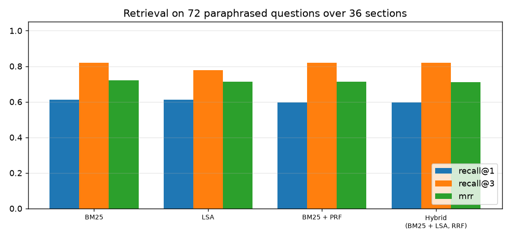
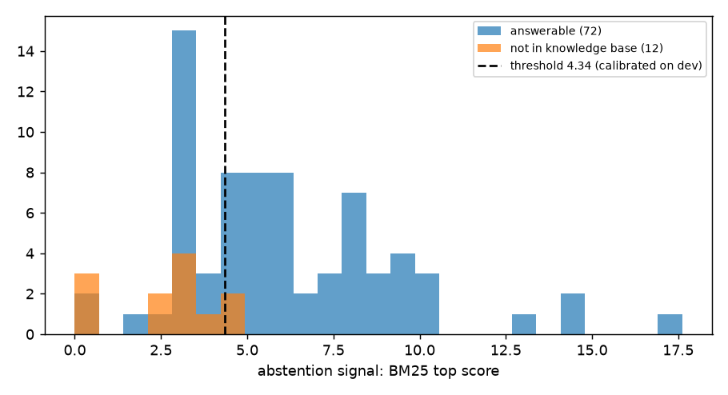
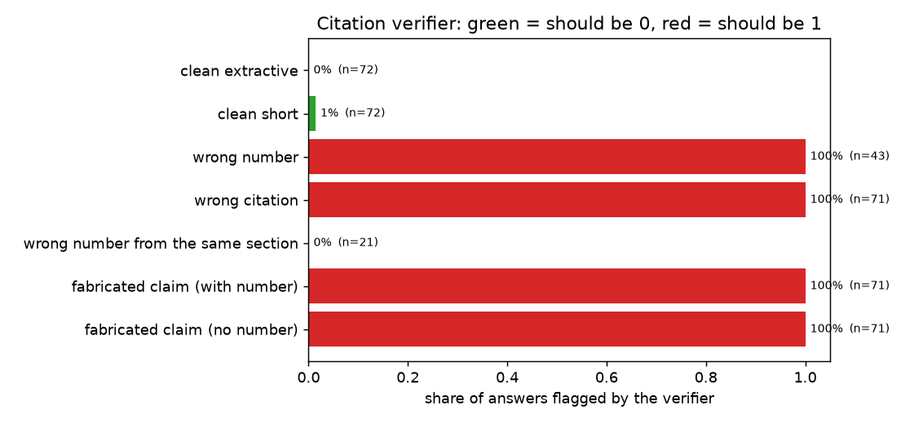

# Enterprise RAG You Can Trust: Abstention and Citation Verification

A retrieval-augmented question-answering system for a large company's policy knowledge base, built around the two questions that decide whether an enterprise will actually deploy RAG:

1. **When the answer is not in the documents, does it say so?** (abstention)
2. **When it does answer, is every claim really supported by the sections it cites?** (citation verification)

```
question ─▶ hybrid retrieval ─▶ abstain? ──yes──▶ "Bu bilgi şirket belgelerinde yer almıyor."
            (BM25 + LSA, RRF)    (calibrated threshold)
                                    │ no
                                    ▼
                      Claude answers with [n] citations ─▶ verifier ─▶ show answer
                                                              │ fails
                                                              ▼
                                         fall back to quoting the best sentence of the sections
```

The verifier is deliberately cheap and auditable (no second LLM call): it checks that **every sentence is cited, every number appears in the cited section, and enough content words are supported**. When Claude's answer fails verification, the system shows a quoted sentence from the same sections instead of an unsupported claim.

## Data

A fictional holding company: **36 policy sections** in 6 areas (IT, procurement, finance, legal, security, communications and sales). Each section has two employee questions written as **paraphrases** (different words than the policy, as real people ask), each with the exact fact that answers it: 72 answerable questions. Another 12 questions are **not covered** by the knowledge base, and several deliberately reuse its vocabulary ("izin", "sağlık", "ev ofis"). Everything is synthetic.

## Results

### Retrieval (72 paraphrased questions)

| Retriever | Recall@1 | Recall@3 | Recall@5 | MRR |
|---|---|---|---|---|
| BM25 (stemmed) | 0.61 | 0.82 | 0.88 | 0.72 |
| LSA (TF-IDF + SVD) | 0.61 | 0.78 | 0.83 | 0.71 |
| BM25 + pseudo-relevance feedback | 0.60 | 0.82 | 0.89 | 0.71 |
| Hybrid (BM25 + LSA, rank fusion) | 0.60 | 0.82 | 0.85 | 0.71 |



**All four are statistically indistinguishable.** With 36 sections, LSA has too little text to learn synonyms from, so neither it nor the hybrid helps. Closing the vocabulary gap ("laptop" vs. "taşınabilir bilgisayar") needs a real multilingual embedding model; this offline project does not include one.

### Abstention

Signal and threshold are chosen on a dev split (first paraphrase of every section plus 6 unanswerable questions) and reported on a disjoint test split (36 answerable, 6 unanswerable):

| Signal | AUROC dev | AUROC test |
|---|---|---|
| BM25 top score (chosen on dev) | 0.81 | 0.88 |
| idf coverage of the question | 0.61 | 0.92 |
| LSA top cosine | 0.60 | 0.78 |

With the chosen signal and threshold: **6 of 6 unanswerable test questions rejected, but 31% of answerable ones are also rejected** (25 of 36 kept). The ranking of signals flips between dev and test, a sign that **42 questions per split are too few to select a signal reliably**. Treat the abstention threshold as a business dial (false answers vs. "I don't know"), and re-calibrate it on real traffic.



### Citation verifier

Answers are corrupted the ways models actually go wrong. Rows in green must not be flagged, rows in red must be:

| Answer type | Flagged |
|---|---|
| Correct, quoted sentence (n=72) | 0% |
| Correct, short value ("10 iş günü [1].") (n=72) | 1% |
| Number replaced by one **not in** the cited section (n=43) | 100% |
| Citation points at the wrong section (n=71) | 100% |
| Fabricated sentence containing a number (n=71) | 100% |
| Fabricated sentence without a number (n=71) | 100% |
| Number replaced by **another number from the same section** (n=21) | **0%** |



The first six rows are easy by construction. The last row is the honest one: **a lexical check cannot tell that "5 days" was answered where the section says "10 days" if both numbers are in the same section.** Catching that needs an entailment model or an LLM judge, and is the natural next step.

### End to end (extractive answerer, test split)

| | |
|---|---|
| Correct section in the top 3 | 83% |
| Correct answer, abstention disabled | 56% |
| Correct answer, with abstention | 50% |
| Unanswerable questions rejected | 6 / 6 |
| Answers passing verification | 100% |

The extractive baseline (quote the best-matching sentence) is weak on purpose: it is the **offline fallback**, not the product. Its limit is picking the right one of two sentences inside a section. The Claude path is where the answer quality should come from.

## What is not verified

The Claude call is tested only against a fake client (prompt construction, verified answers used, hallucinated numbers rejected and replaced by the fallback, API outage and refusal handled). **Claude's real accuracy, and how often its paraphrases would trip the verifier's content-word check, have not been measured.** That requires an API key and a labelled sample.

## Project structure

```
src/entrag/
  corpus.py     # 36 sections, 72 paraphrased questions with ground-truth values, 12 unanswerable
  text.py       # Turkish lowercase, stopwords, prefix stemmer
  retrieval.py  # BM25, LSA, BM25 + PRF, hybrid rank fusion
  verify.py     # sentence-level citation, number and support checks
  answer.py     # abstention, Claude call with fallbacks, extractive fallback, verification
  evaluate.py   # all experiments and figures
tests/          # 14 tests: corpus consistency, verifier cases (incl. its known blind spot), fake-client flows
```

## Quickstart

```bash
python -m venv .venv && source .venv/bin/activate
pip install -r requirements.txt
PYTHONPATH=src python -m entrag.evaluate     # offline, no API key needed
pytest
```

## Tech stack

Python · scikit-learn · BM25 from scratch · Anthropic Claude API · pytest

---

### 🇹🇷 Türkçe özet

Büyük bir şirketin iç politikaları üzerinde çalışan, **bilmediğinde "bilmiyorum" diyen ve verdiği her cevabı kaynağıyla doğrulayan** bir RAG sistemi. Doğrulayıcı, her cümlede alıntı, her sayının alıntılanan bölümde bulunması ve içerik kelimelerinin desteği gibi ucuz ve denetlenebilir kontroller yapıyor; Claude'un cevabı doğrulanamazsa aynı bölümlerden alıntı cümleye düşülüyor. Bulgular dürüst: dört retriever arasında anlamlı fark yok (36 bölüm LSA için çok az), abstention eşiği yanlış alarmı sıfırlıyor ama cevaplanabilir soruların %31'ini de reddediyor, doğrulayıcı uydurma sayıları ve yanlış alıntıları yakalıyor fakat aynı bölümdeki başka bir sayıyla yapılan değişimi (%0) göremiyor. Claude'un gerçek doğruluğu henüz ölçülmedi.
